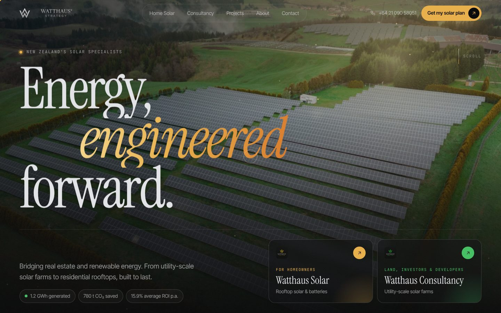
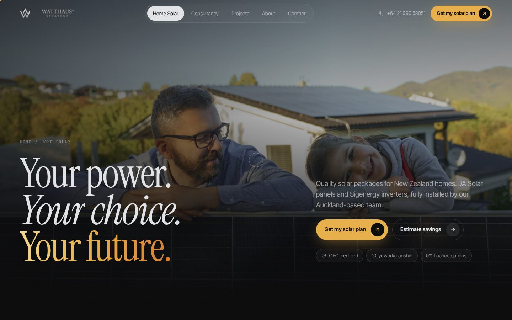
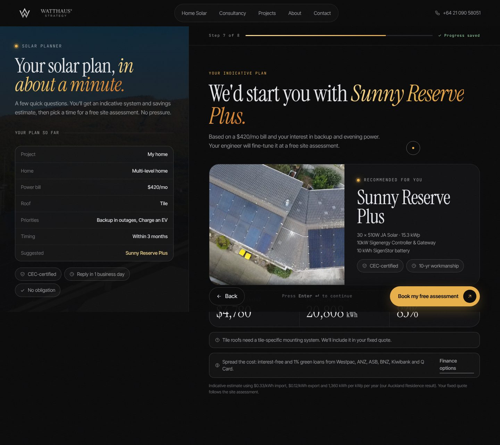
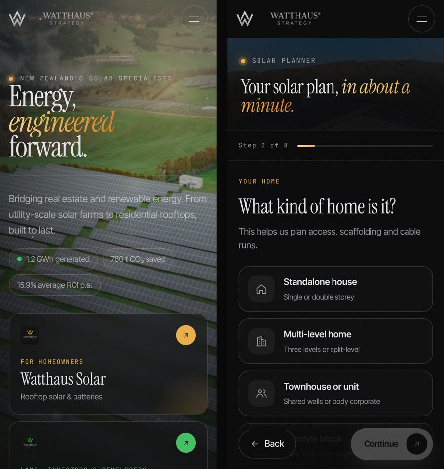

# Watthaus Strategy — website

A multi-page marketing site and solar quote planner for [Watthaus Strategy](https://www.watthausstrategy.co.nz), Auckland.
Static HTML, CSS and vanilla JavaScript: no framework, no dependencies, fast on any host.

**Live preview: https://watthaus.codebunny.net/**



| Home Solar | Solar planner |
| --- | --- |
|  |  |

<p align="center"></p>

## Design

- **Single-colour logo.** The W mark is redrawn as a vector (`#mark` in `src/partials/sprite.svg`, plus `assets/img/favicon.svg`), so it stays crisp at any size and takes on the surrounding text colour. Partner and bank logos are converted to matching single-colour versions in `assets/img/logos/mono/`.
- **Type.** Inter Tight for headlines and body, Instrument Serif italics for accent words, Geist Mono for small labels.
- **Colour.** Carbon black, warm ivory and solar gold; the Consultancy page and cards switch the accent to green.
- **Motion.** First-visit loader, word-by-word headline reveals, a hero slideshow synced to a rotating word, pinned sideways services, stacking process cards and scroll-lit statements. All of it switches off for visitors who ask their device to reduce motion.
- **Page changes happen in place.** Clicking a link covers the screen with the branded panel, fetches the next page and swaps its content into the current document, then lifts the panel. The browser never loads a new document mid-transition, which avoids phone browsers (iPhone Chrome especially) re-measuring the screen and flickering. Back/forward, deep links and sharing still use the real page URLs, and anything unusual falls back to a normal page load. Page-level behaviour lives in `initPage()` in `assets/js/main.js`; anything added there must register a cleanup.

## Pages

| Page | File | What it does |
| --- | --- | --- |
| Home | `index.html` | Cinematic hero with sun-light canvas, two entry paths (Solar / Consultancy), scroll-driven services, packages, a live Auckland sun dashboard, case study, WORX partnership |
| Home Solar | `solar.html` | Savings calculator, four packages, SigenStor hardware, install process, bank finance partners, "things to know" |
| Consultancy | `consultancy.html` | Utility-scale offer for landowners, investors and developers; tabbed service detail; consultation process |
| Projects | `projects.html` | Auckland Residence case study: specs, performance, design considerations, waste audit |
| About | `about.html` | Story, vision and mission, values, founders |
| Contact | `contact.html` | Contact details, enquiry form, founders' direct lines, FAQ |
| Solar planner | `quote.html` | Branching quote funnel (home / business / land) with live estimate and booking |
| 404 | `404.html` | Not-found page |

## The solar planner (`quote.html`)

Built to stop good enquiries leaking out between "interested" and "booked site visit":

- **Three branches.** Homeowners, businesses and landowners each get their own short set of questions.
- **One question per screen.** Big tap targets, number-key shortcuts and Enter to continue; options auto-advance.
- **Instant value.** Homeowners see a recommended package, indicative yearly saving, generation and bill coverage before they're asked for contact details.
- **Books the next step.** Visitors pick a preferred day and morning/afternoon for the site assessment (or discovery call), and can add it to their calendar.
- **Never loses progress.** Answers save in the browser as they go. Come back within 30 days and it offers to resume.
- **Deep links.** `quote.html?path=land`, `quote.html?package=sunny-reserve-plus&battery=1`, `quote.html?bill=300` pre-fill the planner. The savings calculator and package cards already link this way.
- **Ready for analytics.** Every step pushes `wh_quote_start`, `wh_quote_answer`, `wh_quote_step`, `wh_quote_resume` and `wh_quote_submit` to `window.dataLayer` (GA4 / Google Tag Manager) and fires a `wh:quote` DOM event, so drop-off per question can be measured.

## Where leads go

Open `assets/js/config.js` and set `formEndpoint` to any URL that accepts a JSON `POST`
(Formspree, Web3Forms, Basin, a Make/Zapier webhook, or a CRM). Each lead includes name, phone, email,
address, every answer, the recommended package and estimate, preferred booking slot, page, referrer and UTM tags.

Until an endpoint is set, both forms fall back to opening the visitor's email app with the enquiry
pre-filled to `inquiries@watthausstrategy.co.nz`, so nothing is lost.

The savings assumptions (price per kWh, export rate, yield) also live in `config.js`.

## Editing

- Page content: `src/pages/*.html` (a few `key: value` lines at the top, then the page).
- Shared header, menu, footer and icons: `src/partials/`.
- Styles: `assets/css/main.css` (design tokens at the top).
- Behaviour: `assets/js/main.js` and `assets/js/quote.js`.

After editing anything in `src/`, rebuild:

```bash
python3 build.py      # writes the finished pages into the repo root
```

Preview locally:

```bash
python3 -m http.server 8000   # then open http://localhost:8000
```

## Deploying

The repo root is the website: `index.html` and the other pages, plus `assets/`.

- **GitHub Pages:** already live. Settings → Pages deploys branch `main` from the root folder.
- **Netlify:** connect the repo; `netlify.toml` is already set up (publishes the repo root).
- **Vercel / Cloudflare Pages:** framework "Other", build command `python3 build.py`, output directory `.`.
- **Any web server / cPanel:** upload the `.html` files and the `assets/` folder.

## Built in

- Responsive from 320px phones to wide desktops, with a tablet layout and a sticky mobile call / quote bar
- Cross-page transitions (View Transitions API), scroll reveals, split-text headlines, magnetic buttons and a custom cursor on desktop
- Respects "reduce motion": animations switch off for visitors who ask for that
- Semantic HTML, keyboard navigation, focus styles, skip link, alt text, ARIA on tabs, toggles and the planner
- SEO: unique titles and descriptions, canonical URLs, Open Graph image, LocalBusiness structured data
- Images converted to WebP and resized (about 4 MB for the whole site)
